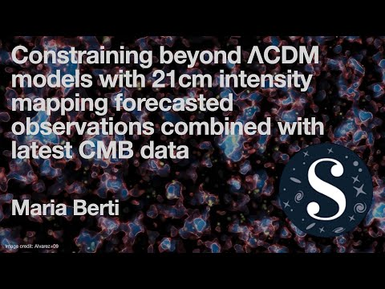

```{=html}
<div class="pagehead"><h1><em>Publications</em></h1><p>Complete record on <a href="https://inspirehep.net/authors/2090111">INSPIRE</a> &nbsp;·&nbsp; <a href="publications.bib">BibTeX</a></p></div>
<div class="ygroup"><div class="yr">2026</div><div><div class="pitem"><div class="kind">Preprint</div><div class="t">The impact of evolving dark energy on the Weyl potential measured from the Dark Energy Survey Year 3 data</div><div class="a">B. Rosatello, G. Ye, <b>M. Berti</b>, I. Tutusaus, N. Grimm, C. Bonvin</div><div class="v">Preprint (2026) <a href="https://arxiv.org/abs/2605.22599">arXiv</a><span class="cit">3 citations</span></div></div><div class="pitem"><div class="kind">Preprint</div><div class="t">Cosmology with HI Intensity Mapping</div><div class="a">L. Wolz, et al. (incl. <b>M. Berti</b>)</div><div class="v">Preprint (2026) <a href="https://arxiv.org/abs/2607.03259">arXiv</a></div></div><div class="pitem"><div class="kind">Published</div><div class="t">Weighing neutrinos with 21cm intensity mapping at the SKAO</div><div class="a">G. Autieri, <b>M. Berti</b>, M. Spinelli, B. S. Haridasu, M. Viel</div><div class="v">JCAP 01 (2026) 050 <a href="https://arxiv.org/abs/2504.18625">arXiv</a><a href="https://doi.org/10.1088/1475-7516/2026/01/050">DOI</a><span class="cit">4 citations</span></div></div></div></div>
<div class="ygroup"><div class="yr">2025</div><div><div class="pitem"><div class="kind">Published</div><div class="t">Reconstructing the dark energy density in light of DESI BAO observations</div><div class="a"><b>M. Berti</b>, E. Bellini, C. Bonvin, M. Kunz, M. Viel, M. Zumalacárregui</div><div class="v">Phys. Rev. D 112 (2025) 023518 <a href="https://arxiv.org/abs/2503.13198">arXiv</a><a href="https://doi.org/10.1103/dj3k-84v4">DOI</a><span class="cit">61 citations</span></div></div></div></div>
<div class="ygroup"><div class="yr">2024</div><div><div class="pitem"><div class="kind">Published</div><div class="t">21 cm intensity mapping cross-correlation with galaxy surveys: current and forecasted cosmological parameters estimation for the SKAO</div><div class="a"><b>M. Berti</b>, M. Spinelli, M. Viel</div><div class="v">MNRAS 529 (2024) 4803 <a href="https://arxiv.org/abs/2309.00710">arXiv</a><a href="https://doi.org/10.1093/mnras/stae755">DOI</a><span class="cit">14 citations</span></div></div></div></div>
<div class="ygroup"><div class="yr">2023</div><div><div class="pitem"><div class="kind">Thesis</div><div class="t">Probing the ΛCDM Universe and beyond with present and future 21cm Intensity Mapping surveys</div><div class="a"><b>M. Berti</b></div><div class="v">PhD thesis, SISSA (2023) </div></div><div class="pitem"><div class="kind">Published</div><div class="t">Cosmological Probes of Structure Growth and Tests of Gravity</div><div class="a">J. Hou, J. Bautista, <b>M. Berti</b>, C. Cuesta-Lazaro, C. Hernández-Aguayo, T. Tröster, J. Zheng</div><div class="v">Universe 9 (2023) 302 <a href="https://arxiv.org/abs/2306.13726">arXiv</a><a href="https://doi.org/10.3390/universe9070302">DOI</a><span class="cit">24 citations</span></div></div><div class="pitem"><div class="kind">Published</div><div class="t">Multipole expansion for 21 cm intensity mapping power spectrum: forecasted cosmological parameters estimation for the SKA Observatory</div><div class="a"><b>M. Berti</b>, M. Spinelli, M. Viel</div><div class="v">MNRAS 521 (2023) 3221 <a href="https://arxiv.org/abs/2209.07595">arXiv</a><a href="https://doi.org/10.1093/mnras/stad685">DOI</a><span class="cit">19 citations</span></div></div><div class="pitem"><div class="kind">Published</div><div class="t">Testing gravity with gravitational waves × electromagnetic probes cross-correlations</div><div class="a">G. Scelfo, <b>M. Berti</b>, A. Silvestri, M. Viel</div><div class="v">JCAP 02 (2023) 010 <a href="https://arxiv.org/abs/2210.02460">arXiv</a><a href="https://doi.org/10.1088/1475-7516/2023/02/010">DOI</a><span class="cit">21 citations</span></div></div><div class="pitem"><div class="kind">Proceedings</div><div class="t">Constraining beyond ΛCDM models with 21cm intensity mapping forecast observations combined with latest CMB data</div><div class="a"><b>M. Berti</b></div><div class="v">Proc. 16th Marcel Grossmann Meeting (2023) <a href="https://doi.org/10.1142/9789811269776_0219">DOI</a></div></div></div></div>
<div class="ygroup"><div class="yr">2022</div><div><div class="pitem"><div class="kind">Published</div><div class="t">Constraining beyond ΛCDM models with 21cm intensity mapping forecasted observations combined with latest CMB data</div><div class="a"><b>M. Berti</b>, M. Spinelli, B. S. Haridasu, M. Viel, A. Silvestri</div><div class="v">JCAP 01 (2022) 018 <a href="https://arxiv.org/abs/2109.03256">arXiv</a><a href="https://doi.org/10.1088/1475-7516/2022/01/018">DOI</a><span class="cit">14 citations</span></div></div></div></div>
<div class="talkshead"><h2>Talks &amp; media</h2><p>10+ talks at international conferences, including 3 invited talks.</p></div>
<div class="talks">
  <div class="talk"><a class="thumb" href="https://www.youtube.com/watch?v=N4BJG-XlA54"><i>▶</i></a><span class="info"><span class="kind">Conference talk · 2022 · 11 min</span><a class="t" href="https://www.youtube.com/watch?v=N4BJG-XlA54">Constraining beyond ΛCDM models with 21cm intensity mapping forecasted observations combined with latest CMB data</a><span class="a">SAZERAC conference, recorded talk. Based on the JCAP 2022 paper above.</span></span></div>
  <div class="talk"><a class="thumb" href="https://www.youtube.com/watch?v=KusktghHZC4"><i>▶</i></a><span class="info"><span class="kind">Interview · 2024 · 13 min</span><a class="t" href="https://www.youtube.com/watch?v=KusktghHZC4">Dr Maria Berti, postdoctoral researcher</a><span class="a">Portrait on Cosmic Blueshift, the YouTube channel of <a href="https://blue-shift.co/">Prof. Camille Bonvin</a>.</span></span></div>
</div>
```
